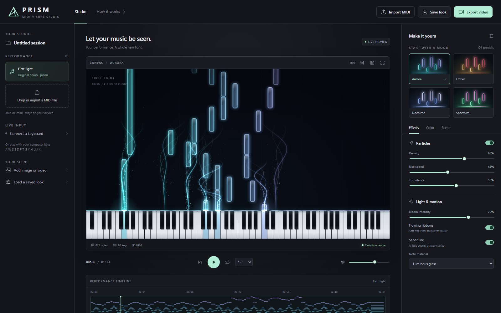

# PRISM MIDI Studio

### Let your music be seen.

Turn your piano performances into glowing notes, flowing ribbons, and reactive light. Shape a look that feels like your music, then capture it as an image or video—all in your browser.

**[Open PRISM →](https://knn-07.github.io/prism-midi-studio/)** · [Getting started](#from-notes-to-light) · [Run locally](#run-locally)



*The included First light demo, shown with the Aurora preset.*

No account. No installation to try it. Your MIDI files and background media stay on your device.

## Make every performance your own

- **Bring your music.** Drop in a `.mid` or `.midi` file, explore the original demo, or connect a MIDI keyboard for live visuals with sustain pedal support.
- **Find your mood.** Start with Aurora, Ember, Nocturne, or Spectrum. Choose glass, solid, or outlined notes, then tune particles, ribbons, glow, and keyboard light.
- **Set the scene.** Add your own background image or video. Adjust colors, darkness, keyboard size, note direction, and travel time.
- **Practice and explore.** Play, pause, seek, loop, and change playback speed. You can also play an octave with your computer keyboard.
- **Make quick MIDI edits.** Open the MIDI editor tab to add, move, resize, or delete notes, adjust velocity, and undo or redo changes. Listen with the shared playback controls, then download your edited MIDI.
- **Keep your signature look.** Settings persist in your browser. Save and load a settings file to reuse or share your style.
- **Capture the moment.** Save a Full HD PNG or record a 720p/1080p video with synthesized piano audio, targeting 30 or 60 fps. Preview the video before downloading it.

## From notes to light

1. **[Open the studio](https://knn-07.github.io/prism-midi-studio/)** and press **Play** to try *First light*, or choose **Import MIDI** to load your performance.
2. **Choose a preset** and make it yours using the Effects, Color, and Scene controls.
3. **Choose Export video** to record your performance or save an image.

For rising MIDI notes, choose **Scene → Note direction → Up from keyboard**. Bars grow upward as notes play and continue rising after release. **Down to keyboard** keeps the original falling-note view. **Travel time** controls how long notes take to cross the canvas in either direction. The direction is saved with your look and applies to images and video exports; music still plays forward.

For quick corrections, switch to **MIDI editor** above the preview. Select a note to change its pitch, start, length, or velocity; drag it to move it, or drag its right edge to resize. Use **Add note** or double-click an empty area to draw a note. Changes apply to playback and the visualizer immediately and stay in this session; choose **Download MIDI** to keep them before reloading or importing another performance.

The editor uses seconds for timing, with optional snapping based on the performance's initial BPM. MIDI downloads write note timings and track names at a constant tempo; they do not preserve the original tempo map, pedal controllers, or other non-note events. Overlapping repetitions of the same pitch on the same channel can have different release lengths when reopened in MIDI software.

For live input, connect a MIDI keyboard and choose **Connect a keyboard**. No keyboard handy? Use `A W S E D F T G Y H U J K` to play from C4.

| Shortcut | Action |
| --- | --- |
| `Space` | Play / pause |
| `←` / `→` | Seek backward / forward five seconds |
| `L` | Toggle loop |
| `M` | Toggle mute |

## Private by design

PRISM processes your files locally in the browser. There are no media uploads, accounts, API keys, or app telemetry. Once the studio has loaded, editing and playback work without an internet connection; reopening or reloading the hosted app requires a connection.

## Before you record

Use desktop Chrome or Edge for the fullest MIDI and recording support. Live MIDI requires HTTPS or localhost, a compatible device, and browser permission.

Video recording runs **in real time**, from the start of the performance at 1× speed. Keep the tab visible and your computer awake; hiding the tab ends recording early. Long recordings use browser memory. The available video format depends on your browser: WebM is preferred, with MP4 used when supported instead.

Audio comes from PRISM's built-in synthesized piano. Background videos are visual only; microphone and external-instrument audio are not recorded. Live keyboard input is visualized but is not saved as a MIDI performance for later export.

For lighter graphics usage, choose **Scene → Preview quality → Low power**. Preview quality does not reduce the resolution of saved images or your chosen video export.

<details>
<summary>Supported MIDI files and playback details</summary>

PRISM supports Standard MIDI formats 0 and 1. Format 2 and SMPTE-timed files are not supported. All MIDI instruments use the same synthesized piano voice; instrument program changes and pitch bend are not reproduced.

PRISM includes a quick piano-roll note editor. It does not transcribe audio into MIDI.

</details>

## Run locally

With [Node.js](https://nodejs.org/) 20 or newer installed:

```sh
git clone https://github.com/KNN-07/prism-midi-studio.git
cd prism-midi-studio
npm run dev
```

Open **http://127.0.0.1:5173**. No package installation is needed. To use another port, run `npm run dev -- --port 5174`.

## Development

PRISM uses vanilla JavaScript, Canvas 2D, and the Web Audio API, with no runtime dependencies or bundler.

```sh
npm test                 # Automated tests
npm run benchmark        # MIDI parsing, indexing, and export timings
npm run build            # Create the static dist/ directory
node scripts/serve.mjs --dist
```

The static build can be served by any static web host. The public demo is hosted on GitHub Pages from the `gh-pages` branch. Source pushes to `main` run tests and build a downloadable artifact; they do not automatically update the public demo. Opening `index.html` directly via `file://` is unsupported because browsers restrict JavaScript modules.

Rendering uses an on-demand frame loop, indexed note queries, bounded texture caches, and cached static layers to reduce repeated work. Hidden previews stop drawing, and preview quality controls pixel and frame-rate budgets independently of export settings.

| Location | Purpose |
| --- | --- |
| `src/app.js` | Studio UI, transport, settings, and export |
| `src/renderer.js` | Piano, notes, lighting, and particles |
| `src/midi.js`, `src/audio.js`, `src/live-midi.js` | MIDI files, demo composition, synthesis, and live input |
| `src/midi-editor.js`, `src/midi-edit.js` | Piano-roll editor and immutable note editing |
| `src/frame-loop.js`, `src/preview.js` | Rendering cadence and preview quality |
| `src/note-index.js`, `src/note-sprites.js` | Note queries and glow texture caching |
| `src/model.js` | Settings and presets |
| `scripts/`, `tests/` | Static server, build, benchmarks, and automated checks |

## Credits and license

Inspired by the piano effects demonstrated by [SeeMusic](https://www.seemusicapp.com/features). PRISM is an independent project and is not affiliated with SeeMusic. No SeeMusic code, artwork, recordings, or proprietary assets are included. The demo music and visual assets are original to this project.

Open source under the [MIT License](LICENSE).
